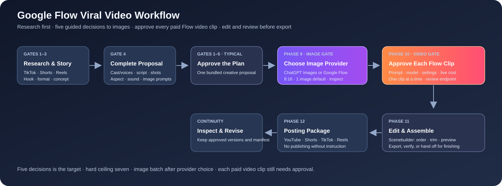

# Google Flow Workflow

An approval-driven production playbook for planning original short-form stories, creating reference images with the user's chosen image provider, rendering video in Google Flow, editing clips into a sequence, and preparing platform-specific publishing materials.

## The workflow at a glance

**Core rule:** still-image production begins with one provider choice—ChatGPT Images or Google Flow Images. That choice authorizes the planned image set in the approved production package. Generate and inspect the set, retry clear defects without per-image approvals, then show all results together for selection. Videos render in Google Flow, and each video clip requires explicit approval of its prompt, settings, and displayed credit cost before generation.

**Start the workflow in any chat by saying `FlowStart`.** The installed `google-flow-start` Codex skill makes this trigger discoverable in a fresh chat. It loads this workspace's canonical prompt and workflow, resumes saved project state when available, and otherwise starts at Gate 1. The trigger means begin immediately, not merely acknowledge it. Before making trend, format, hook, or platform recommendations, the assistant researches dated evidence across TikTok, YouTube Shorts, and Instagram Reels (plus any other platforms in the brief) and gives a compact cited research basis. The workflow stays interactive, advances after every choice, aims for five required decisions before the first image batch, and never exceeds seven unless the user asks to explore further. Related creative choices are bundled.

**First action on a fresh `FlowStart`:** The first tool call must open Google Flow in the ChatGPT/Codex built-in in-app browser; do not send a question or menu first. Navigate to the Flow main page, sign in there if needed, and click **+ New project** even if an old project is open. Only after the new workspace is visible may research or questions begin. Never launch or switch to the user's external browser.

**Easy choices:** Every decision and approval gate presents lettered or numbered options, with one **Recommended** choice and a brief reason. Show the full practical menu (often six or seven choices) instead of arbitrarily narrowing open-ended decisions. Include **Choose for me** and **Describe my own** where relevant; use short **Approve / Revise / Stop** menus for approval gates. In chat, reply with just the letter or number.

## Documents

- [Universal Viral Video Workflow](UNIVERSAL%20VIRAL%20VIDEO%20WORKFLOW.md) — the complete 12-phase workflow, including the researched viral micro-drama pitch mode, reusable character voice creation, image-batch production and QC, per-clip Flow video approval, Scenebuilder cuts, Flow Agent edits, Extend limitations, continuity checks, and posting package.
- [System Prompt](system%20prompt.md) — standing assistant behavior and current beginner Google Flow procedures.
- [Video Editing Prompt](video%20editing%20prompt.md) — copy-ready template for planning and editing a project.
- [Style Library](STYLE%20LIBRARY.md) — the 243 style options from the supplied master prompt, with catalog codes.
- [Workflow Diagram](assets/google-flow-viral-workflow.svg) — visual overview.
- [Google Flow Operations Field Guide](GOOGLE%20FLOW%20OPERATIONS%20FIELD%20GUIDE.md) — current official-documentation-derived guidance for models, modes, settings, credits, privacy, edits, and asset management.
- [Google Flow Character and Voice Guide](GOOGLE%20FLOW%20CHARACTER%20AND%20VOICE%20GUIDE.md) — character creation, voice customization, attachment, and supported voice-reference workflow.
- [google-flow-start skill](skills/google-flow-start/SKILL.md) — reusable startup and resume instructions that make `FlowStart` work in fresh chats.

## FlowStart research and decision limits

- Recommendations begin with current, dated research across TikTok, YouTube Shorts, and Instagram Reels. Evidence and creative inference are labeled separately; sources are linked in the response and kept in the project note.
- Trend research targets the user's stated niche, language, geography, and audience where known. It never guarantees reach or claims a universal trend from one forecast.
- Before the image batch, the assistant aims for five required decision questions and never exceeds seven unless the user requests more exploration. Style, format, story, cast/voice, setting, script, runtime, shot plan, framing, and sound are bundled where possible.
- The assistant keeps the process moving after each answer. Image-provider choice authorizes the planned still-image batch and its autonomous QC/retries. Each paid Google Flow video generation still requires its own explicit, clip-specific approval.

### Trend research baseline checked October 16, 2026

These current references inform the research method; each new FlowStart must check for newer evidence and niche-specific signals:

- [TikTok Next 2026 forecast](https://newsroom.tiktok.com/introducing-tiktok-next-2026-our-trend-forecast-for-marketers-for-the-year-ahead?_hsmi=399120832&lang=en) (Jan. 14, 2026): TikTok's forecast emphasizes active discovery, curiosity, community, and meaningful audience value. It is a forecast, not proof of a niche trend.
- [YouTube Shorts Series and micro-drama update](https://blog.youtube/news-and-events/made-on-youtube-creators-shorts-series-tv-features/) (Sept. 23, 2026): YouTube announced episodic Shorts organization and reported more than 6.5 billion micro-drama views in H1 2026, with watch time up over 50% year over year. This indicates platform-scale interest, not guaranteed performance for a particular series.
- [Meta's 2026 update](https://about.fb.com/news/2026/01/2026-ai-drives-performance/) (Jan. 28, 2026): Meta said 75% of Instagram recommendations in the US in Q4 2025 came from original posts; the geography and reporting period matter.
- [Metricool's 2026 short-form report](https://metricool.com/short-video-report/) (Aug. 26, 2026): third-party cross-platform analysis of more than 6.1 million videos across Instagram, TikTok, and YouTube; use it for comparison context, not prediction.

## Default image and video controls

| Work | Default | Approval rule |
|---|---|---|
| Image generation | Ask once for ChatGPT Images or Google Flow Images; 9:16 portrait; one image per prompt, all planned prompts batched when supported. Flow image model: Nano Banana 2.1 when available. | Provider choice authorizes the planned image set. QC and retry defects automatically, then present the batch for selection; no per-image generation approvals. |
| Video rendering | Google Flow only; one clip at a time; verify supported mode, model, aspect, duration, output count, and current credit cost. | Require explicit approval for each specific clip and settings before Generate. Re-approval is required after a material change. |
| Basic editing | Flow desktop Scenebuilder: arrange clips, reorder, trim in/out, preview, and download. | Preserve originals. AI-assisted edits/extensions are media generation and need their own cost approval. |

These defaults reflect the user's requested workflow, not a promise that every feature is available in every account or region. Check the live Flow interface and its displayed costs each time.

## Flow editing essentials

1. Add accepted clips to a Scene/Scenebuilder, arrange them in story order, and use each clip's handles to trim its beginning and end.
2. Preview the complete sequence and inspect cuts for clipped dialogue, unfinished movement, repeated frames, awkward pacing, or abrupt audio changes.

## Character voice workflow

Every speaking character receives a planned and saved Flow voice as part of character creation. The workflow defines a stable voice lock (language/accent, register, texture, pace, articulation, baseline delivery, and emotional range), then in Flow selects and customizes a preset, names the voice, enters representative sample dialogue, previews the performance, saves the custom voice, attaches it to the correct Character, and verifies the Character sheet. If the preview is unsuitable, revise and preview again. Keep stable voice identity separate from scene-specific delivery, and never claim an audio preview was heard when it was not accessible. See [system prompt.md](system%20prompt.md) and [UNIVERSAL VIRAL VIDEO WORKFLOW.md](UNIVERSAL%20VIRAL%20VIDEO%20WORKFLOW.md).

For Google's documented character controls, custom voice creation steps, and voice-reference restrictions by model/mode, see the dedicated [Google Flow Character and Voice Guide](GOOGLE%20FLOW%20CHARACTER%20AND%20VOICE%20GUIDE.md). In particular, current Google Help documents voice references for Omni Flash video using Ingredients and a single-speaker voice reference; verify the live model picker because product availability can change.

The broader [Google Flow Operations Field Guide](GOOGLE%20FLOW%20OPERATIONS%20FIELD%20GUIDE.md) collects current practices for Agent behavior, settings layers, model/mode compatibility, credits, image batches and edits, video editing and Scenebuilder, asset history, privacy, exports, troubleshooting, and useful shortcuts. It is version-sensitive and links to Google's Help Center for rechecking.
3. Use Agent/video editing for a focused change to a selected clip. Say what must stay fixed and change one main thing at a time. Compare versions in History/asset stack; keep the original.
4. Extend a clip only when the selected model supports it. Confirm the exact model, limitation, duration, and cost before approval.
5. Download the scene and verify the file. Use a dedicated editor for detailed audio mixing, captions, titles, grading, or frame-accurate finishing beyond Flow's current controls.

Google's current Help Center documents the desktop editor and Scenebuilder here: [Edit videos and build scenes in Google Flow](https://support.google.com/flow/answer/16935718?hl=en). Model compatibility, upload constraints, geography, and costs can change.

## Local production folders and editing handoff

Once the story and working title are agreed, create the named project folder under the active Google-Flow workspace immediately. Keep the project's references, story and prompts, Flow downloads, captions/audio, editable HyperFrames working files, and final exports together there. **Phase 11 starts after all approved Flow videos are ready:** download and verify every video, plus the approved Flow scene if available, before editing. Then continue in the same project chat and use the HyperFrames skill/plugin; preserve the originals and keep editable files and final renders in their separate folders. Keep private project media local by default; publish reusable workflow documentation separately. Use HyperFrames for timed captions, detailed sound, titles, and final finishing beyond Scenebuilder's documented sequencing/trimming controls.

Phase 12's detailed posting package is delivered as a polished native Google Doc, not a Markdown file. Each platform gets distinct copy, options with a recommendation, cover guidance, pinned comment/CTA, accessibility, upload fields, disclosure/music checks, and a destination-specific checklist. Include cross-post order and performance tracking. Put the verified Docs link in the project README and keep export-dependent details pending until Phase 11 is complete. Publishing still requires explicit authorization.

## Approval checkpoints

The phases are: **Style → Story → Cast → Runtime/Scenes/Shots → Speech/Audio → Format/Platforms → Concept Approval → Text Production Package → Images → Flow Video Clips → Editing Handoff → Posting Package**.

- Concept approval locks the creative plan, not generated assets.
- Image provider selection happens before images are made. Generated images are checked against their prompts and continuity references.
- When consistency matters, attach the exact approved character, location, prop, or frame as a Flow ingredient when supported. Use Flow's current Add/drag/`@name` controls, state each reference's role, and verify the attached asset; IDs belong in the tracking ledger unless Flow exposes ID lookup.
- Inspect generated stills at readable size for physical plausibility as well as visual quality. In particular, a phone screen/UI must appear on its front glass; a visible rear casing or back-camera side cannot show display content. Autonomously regenerate clear defects with a targeted correction and inspect the replacement before accepting it.
- Each Flow video generation is an individual spend decision. The assistant must show the exact clip, model/mode, frame inputs, orientation, duration, output count, prompt, and live cost, then wait for explicit approval.
- Editing preparation, a ZIP, or a finished prompt is not permission to render video or publish.

## Updating the knowledge base

Prefer official Google Flow Help for current interface/model details. Treat tutorial recordings as examples rather than guarantees. When updating this repository, record newly observed behavior, which model/mode was selected, what was verified in the UI, and any limits or region/account caveats. Never record private account details or claim an action succeeded without evidence.

## Sources

- [Google Flow Help Center](https://support.google.com/flow/)
- [Create videos in Flow](https://support.google.com/flow/answer/16353334?hl=en)
- [Use the Flow Agent](https://support.google.com/flow/answer/17093911?hl=en)
- [Edit videos and build scenes](https://support.google.com/flow/answer/16935718?hl=en)
- [Models and supported features](https://support.google.com/flow/answer/16352836?hl=en)
- [Manage Flow credits](https://support.google.com/flow/answer/16526234?hl=en)
